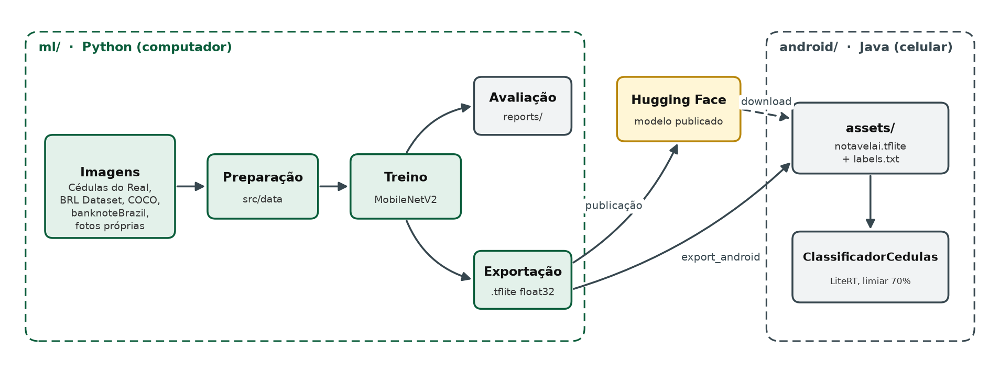
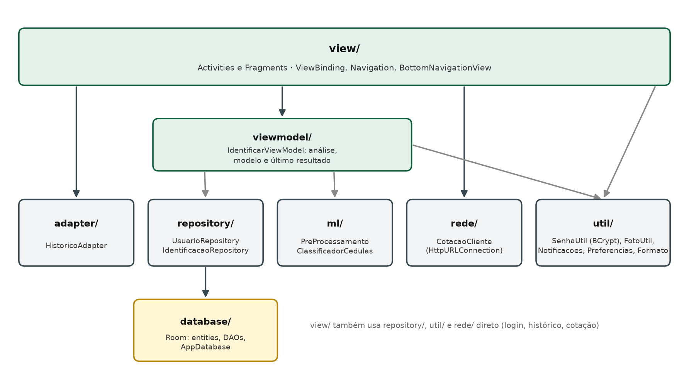
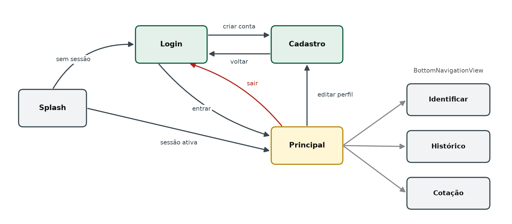
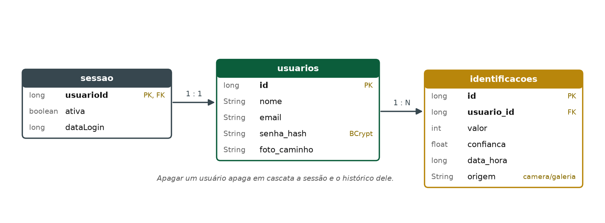
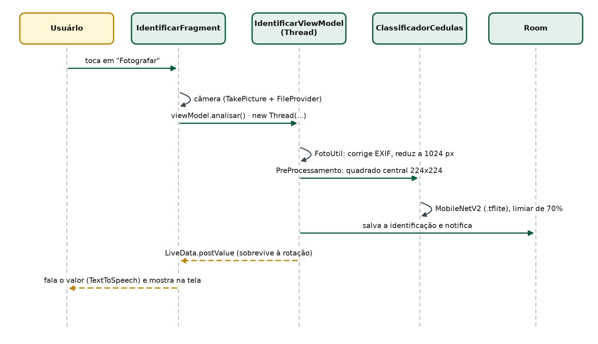

# NotavelAI

App Android que reconhece cédulas de Real pela câmera e **fala o valor em voz alta**, para pessoas
cegas ou com baixa visão. O reconhecimento roda **no próprio celular, sem internet**, com um modelo
de visão computacional treinado para isso.

Projeto da disciplina de Programação Mobile da UFMS (2026), grupo DreamTeam.

| Parte | Onde | Documentação |
| --- | --- | --- |
| App Android (Java) | [`android/`](android/) | [`android/README.md`](android/README.md) |
| Modelo de ML (Python) | [`ml/`](ml/) | [`ml/README.md`](ml/README.md) |
| Modelo publicado | 🤗 [huggingface.co/arthursilvadantas/NotavelAI](https://huggingface.co/arthursilvadantas/NotavelAI) | model card bilíngue |

## Visão geral da arquitetura

O projeto tem dois ciclos: o **ciclo de ML**, que roda no computador e produz o modelo, e o **ciclo
do app**, que roda no celular e usa o modelo.



O contrato entre as duas partes é pequeno e testado dos dois lados:

| | Contrato |
| --- | --- |
| Arquivos | `notavelai.tflite`, `labels.txt` |
| Entrada | `[1, 224, 224, 3]`, RGB, float32, 0–255, sem normalizar; o quadrado central da foto, reduzido a 224×224 |
| Saída | 8 probabilidades: `2, 5, 10, 20, 50, 100, 200, fundo` |
| Decisão | anuncia o valor só com confiança de pelo menos 70% e classe diferente de `fundo` |
| Garantia | `PreProcessamentoTest` (Java = Keras) e `ClassificadorCedulasTest` (celular = Python nas 24 fotos de teste) |

## App Android

### Camadas



| Pacote | Responsabilidade |
| --- | --- |
| `view/` | telas: `SplashActivity`, `LoginActivity`, `CadastroActivity` e `MainActivity`, com os fragmentos `IdentificarFragment`, `HistoricoFragment` e `CotacaoFragment` |
| `viewmodel/` | `IdentificarViewModel`: análise, modelo e último resultado, que sobrevivem à rotação da tela |
| `adapter/` | adapter da lista do histórico |
| `repository/` | regras sobre o banco: login, sessão, cadastro e histórico do usuário |
| `database/` | Room: tabelas, consultas (DAOs) e a instância única do banco |
| `ml/` | pré-processamento da foto (quadrado central) e execução do modelo com LiteRT |
| `rede/` | consulta de cotações de moedas na AwesomeAPI |
| `util/` | hash de senha, leitura de fotos, notificações, preferências e formatação |

### Navegação



### Banco de dados (Room)



Apagar um usuário apaga em cascata a sessão e o histórico dele.

### Fluxo de uma identificação



### Decisões de arquitetura

- **Threads:** o Room é criado sem `allowMainThreadQueries()`. Banco, BCrypt, leitura de fotos,
  modelo e HTTP rodam em `new Thread(...)`, e a tela é atualizada com `runOnUiThread`, `Handler` ou
  `LiveData`. A interface nunca trava.
- **Rotação da tela:** a identificação fica no `IdentificarViewModel`. Ao voltar da câmera com o
  celular deitado, o Android recria a tela, e o resultado não se perde nem deixa de ser falado.
- **Offline primeiro:** o reconhecimento não usa internet. Só a cotação depende de rede, com
  verificação de conexão antes e cache de 5 minutos.
- **Segurança:** senhas guardadas só como hash BCrypt; senha atual exigida para editar o perfil;
  foto de perfil na pasta interna do app; backup do Android desativado.
- **Acessibilidade:** contraste mínimo de 6:1 nos temas claro e escuro, alvos de toque de 56 dp,
  rótulos para o TalkBack, resultados em live regions, valor falado em voz alta e ajustes de tema,
  tamanho do texto e fala. Verificado automaticamente pelo `AcessibilidadeTest`.
- **Resposta conservadora:** abaixo de 70% de confiança, o app diz que não conseguiu identificar em
  vez de arriscar um valor errado.

## Modelo de ML

MobileNetV2 (ImageNet) com ajuste fino da rede inteira, que recebe o quadrado central da foto.
Treinada com 2.713 imagens: 1.142 fotos reais do dataset [Cédulas do Real](https://www.kaggle.com/datasets/karenalmeida340/cdulas-do-real)
(Kaggle), 500 do banknoteBrazil, recortes do BRL Dataset, composições, a classe `fundo` e fotos de
celular do grupo.

| Teste (fotos nunca vistas no treino) | Acertos | Valores falados certos / errados |
| --- | ---: | ---: |
| Cédulas do Real, metade do teste dos autores (135) | 95,6% | 127 / 2 |
| Cédulas do Real, conjunto extra dos autores (66) | 93,9% | 59 / 3 |
| Fotos de celular do grupo (24) | 79,2% | 18 / 0 |

Dados, treino, divisão dos conjuntos e limitações estão em [`ml/README.md`](ml/README.md) e no
[Hugging Face](https://huggingface.co/arthursilvadantas/NotavelAI). É um protótipo acadêmico e não
deve ser a única forma de conferir dinheiro.

## Tecnologias

| Área | Tecnologias |
| --- | --- |
| App | Java 11, Android SDK 37 (mínimo 26), AndroidX, Material Components, Navigation, ViewBinding, Splash Screen API |
| Dados no app | Room 2.6 (SQLite), SharedPreferences |
| Segurança | jBCrypt |
| IA no celular | LiteRT 2.3 (TensorFlow Lite) |
| Rede | HttpURLConnection + AwesomeAPI |
| Testes do app | JUnit, Espresso, Accessibility Test Framework |
| ML | Python 3.12, TensorFlow 2.21, Keras 3, NumPy, Pillow, Jupyter, pytest |

## Onde fica cada coisa

| Lugar | Conteúdo |
| --- | --- |
| **GitHub** (este repositório) | todo o código: `android/` e `ml/` |
| **[Hugging Face](https://huggingface.co/arthursilvadantas/NotavelAI)** | o modelo treinado (`.keras` e `.tflite`), página, licença e exemplo de uso |
| **Fora do Git** | imagens (`ml/data/`) e pesos do modelo |

## Começando

```bash
# app: abra android/ no Android Studio e clique em Run, ou pela linha de comando
# (na primeira compilação, o Gradle baixa o modelo do Hugging Face sozinho)
cd android
./gradlew assembleDebug

# modelo (Python 3.12)
cd ../ml
uv venv --python 3.12 .venv
uv pip install --python .venv/bin/python -r requirements.txt
.venv/bin/python -m pytest
```
