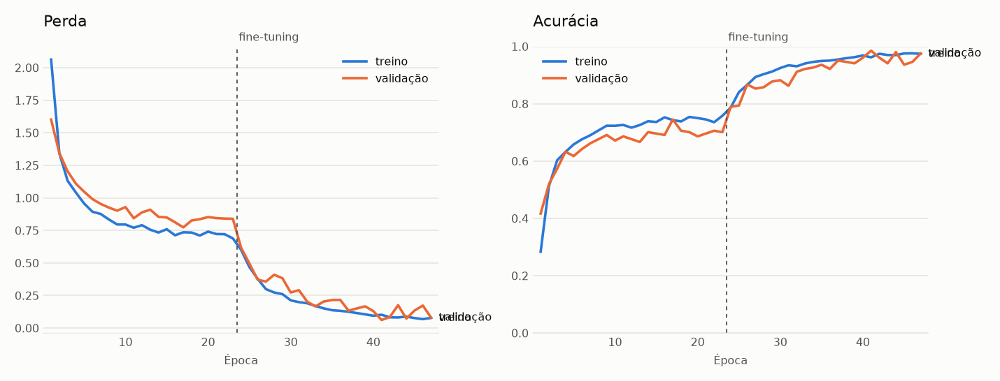

# NotavelAI · Brazilian Real banknote recognition

**🤗 Model on Hugging Face / Modelo no Hugging Face: <https://huggingface.co/arthursilvadantas/NotavelAI>**

This folder holds the code that builds the model; the [Android app](../android/README.md) is in
`../android`. / Esta pasta tem o código que gera o modelo; o [app Android](../android/README.md)
fica em `../android`.

**[English](#english) · [Português](#português) · [Code / Código](#code--código)**

<a id="english"></a>

## English

NotavelAI is an Android app for blind and visually impaired people: the user takes a photo of a
banknote and the app **speaks its value out loud**. This repository holds the computer vision model
that runs inside the app, **offline, on the phone**.

| | |
| --- | --- |
| **Task** | image classification: which Brazilian Real banknote is in the photo, if any |
| **Classes** | R$ 2, 5, 10, 20, 50, 100, 200 and `fundo` (no Real banknote) |
| **Model** | MobileNetV2 (ImageNet), fully fine-tuned |
| **Formats** | TensorFlow Lite float32 (`.tflite`, used by the app) and Keras (`.keras`) |
| **Size on device** | 8.9 MB |
| **Accuracy on unseen real photos** | 95.6% (135 photos) and 93.9% (66 photos) |
| **License** | academic and research use only ([why](#license)) |
| **Status** | academic prototype; not reliable as the only way to check money |

Built for the Mobile Programming course at UFMS (Brazil), 2026, by the DreamTeam group.

### Files on Hugging Face

```text
├── tflite/notavelai.tflite        model for Android / LiteRT
├── keras/notavelai.keras          same model for Python (retraining, fine-tuning)
├── evaluation/
│   ├── evaluation.csv             accuracy and announced values per test set
│   └── phone_predictions.csv      answer for each of the group's phone photos
├── images/training_curves.png     training curves
├── labels.txt                     the 8 classes in output order
├── classes.json                   same order, as JSON
├── predict.py                     ready-to-run example
└── LICENSE
```

### Quick start

```bash
pip install tensorflow pillow numpy huggingface_hub
hf download arthursilvadantas/NotavelAI --local-dir NotavelAI
python NotavelAI/predict.py photo.jpg
# photo.jpg: R$ 20 (96%)
```

`predict.py` reproduces the app: it takes the central square of the photo and only announces a
value at 70% confidence or more. Below that it answers "not sure"; for someone who cannot see the
banknote, hearing a wrong value is worse than hearing nothing.

### How it works

```text
photo ─► fix EXIF rotation ─► cap at 1024 px ─► central square ─► resize to 224×224
      ─► MobileNetV2 ─► 8 probabilities ─► most likely class (announced if ≥ 70% and not fundo)
```

- **Input:** `[1, 224, 224, 3]`, RGB, float32, values **0–255, not normalized** (scaling to
  [-1, 1] is inside the model).
- **Output:** `[1, 8]`, float32 probabilities in the order of `labels.txt`:
  `2, 5, 10, 20, 50, 100, 200, fundo`.
- **Preprocessing matters:** take the largest central square (start = half the leftover, rounded
  down) and resize it with bilinear interpolation, no antialias, like
  `keras.preprocessing.image.smart_resize`. The banknote should be in the middle of the photo.

### Training

| Step | Setting |
| --- | --- |
| Backbone | MobileNetV2 pre-trained on ImageNet, 224×224 input |
| Head | global average pooling, dropout 0.3, dense softmax with 8 outputs |
| Phase 1 | frozen backbone, head only; Adam, learning rate 1e-3; stopped at epoch 23 (best: 17) |
| Phase 2 | whole network fine-tuned; learning rate 2e-5; stopped at epoch 24 (best: 18) |
| Stopping | early stopping, patience 6; keeps the lowest `val_loss` |
| Augmentation | rotation, zoom, horizontal flip, brightness, contrast (not in the exported model) |
| Batch | 32 |
| Class imbalance | class weights |

**Training data (2,713 images):**

| Source | Images | What it is |
| --- | ---: | --- |
| [Cédulas do Real](https://www.kaggle.com/datasets/karenalmeida340/cdulas-do-real) (Kaggle, MIT) | 1,142 | real phone photos with varied backgrounds, the original training images of the authors (their augmented copies were not used) |
| [banknoteBrazil](https://github.com/joaofracasso/banknoteBrazil) | 500 | phone photos of R$ 2 to R$ 50 on a table (academic use only) |
| Composites | 480 | banknote crops pasted on scenes, plus background patches |
| BRL Dataset (Roboflow Universe, CC BY 4.0) | 427 | annotated photos cropped around each banknote |
| `fundo` class | 120 | coins and empty regions from the BRL Dataset, and [COCO 2017](https://cocodataset.org/) images |
| Group's phone photos | 44 | taken and labeled by hand, including US dollar bills as `fundo` |

The test splits defined by the Kaggle authors were kept out of training: half of their test split
is used for validation (best epoch and threshold), the other half and their extra set for testing.



### Results

All sets are photos the model never saw during training. "Speaks right / wrong" counts the times
the app would announce a value (confidence ≥ 70% and class other than `fundo`).

| Test set | Accuracy | Speaks right | Speaks wrong |
| --- | ---: | ---: | ---: |
| Cédulas do Real, half of the authors' test split (135) | **129 (95.6%)** | 127 | 2 |
| Cédulas do Real, authors' extra set (66) | **62 (93.9%)** | 59 | 3 |
| Group's phone photos (24) | **19 (79.2%)** | 18 | 0 |

For reference, the paper behind the Kaggle dataset (Almeida et al., 2025) reports 99.6% on the
whole test split and 100% on the extra set with a SqueezeNet that runs on a server; NotavelAI runs
**offline on the phone**. Their test and training photos come from the same capture sessions, so
both numbers are optimistic.

**Latency:** about 2 ms per photo on an Apple Silicon Mac CPU, 1 thread.

### Limitations

- **First-series (old) banknotes** were barely in the training data: in our tests, the old R$ 100
  and R$ 10 were often missed.
- **R$ 5 vs R$ 10** is the most common confusion.
- **Framing:** the model looks at the central square; a small banknote far from the center may be
  answered as `fundo` (in the group's photos, 2 of 5 R$ 200 notes were).
- **Photos of screens** (a banknote shown on a monitor) are much harder than real banknotes.
- **Foreign currency:** only US dollars were seen as `fundo`; one dollar photo came close to the
  threshold as R$ 100.
- **Counterfeits:** the model does not check authenticity.

### Intended use

- **Suitable:** research, teaching and assistive technology prototypes.
- **Not suitable:** the only way for a person to check money, cash registers, vending machines, or
  any commercial use.

### License

**Academic and research use only** (see [`LICENSE`](https://huggingface.co/arthursilvadantas/NotavelAI/blob/main/LICENSE)). The model was trained on images from
banknoteBrazil, released by its author for academic research only. The other sources (Cédulas do
Real, MIT; BRL Dataset and COCO, CC BY / CC BY-SA) require attribution, given in the license.

---

<a id="português"></a>

## Português

O NotavelAI é um app Android para pessoas cegas ou com baixa visão: a pessoa fotografa uma cédula e
o app **fala o valor em voz alta**. Este repositório tem o modelo de visão computacional que roda
dentro do app, **offline, no próprio celular**.

| | |
| --- | --- |
| **Tarefa** | classificação de imagem: qual cédula de Real está na foto, ou nenhuma |
| **Classes** | R$ 2, 5, 10, 20, 50, 100, 200 e `fundo` (sem cédula de Real) |
| **Modelo** | MobileNetV2 (ImageNet), com ajuste fino da rede inteira |
| **Formatos** | TensorFlow Lite float32 (`.tflite`, usado pelo app) e Keras (`.keras`) |
| **Tamanho no celular** | 8,9 MB |
| **Acerto em fotos reais nunca vistas** | 95,6% (135 fotos) e 93,9% (66 fotos) |
| **Licença** | somente uso acadêmico e de pesquisa ([por quê](#licença)) |
| **Estado** | protótipo acadêmico, não confiável como única forma de conferir dinheiro |

Projeto da disciplina de Programação Mobile da UFMS, 2026, grupo DreamTeam.

### Arquivos no Hugging Face

```text
├── tflite/notavelai.tflite        modelo para Android / LiteRT
├── keras/notavelai.keras          o mesmo modelo para Python (retreino, fine-tuning)
├── evaluation/
│   ├── evaluation.csv             acertos e valores anunciados por conjunto de teste
│   └── phone_predictions.csv      resposta para cada foto de celular do grupo
├── images/training_curves.png     curvas de treino
├── labels.txt                     as 8 classes na ordem das saídas
├── classes.json                   a mesma ordem, em JSON
├── predict.py                     exemplo pronto para rodar
└── LICENSE
```

### Início rápido

```bash
pip install tensorflow pillow numpy huggingface_hub
hf download arthursilvadantas/NotavelAI --local-dir NotavelAI
python NotavelAI/predict.py foto.jpg
# foto.jpg: R$ 20 (96%)
```

O `predict.py` reproduz o app: usa o quadrado central da foto e só anuncia um valor com pelo menos
70% de confiança. Abaixo disso responde "não consegui identificar": para quem não enxerga a nota,
ouvir um valor errado é pior do que não ouvir nada.

### Como funciona

```text
foto ─► endireita pela EXIF ─► limita a 1024 px ─► quadrado central ─► reduz a 224×224
     ─► MobileNetV2 ─► 8 probabilidades ─► classe mais provável (anunciada se ≥ 70% e não for fundo)
```

- **Entrada:** `[1, 224, 224, 3]`, RGB, float32, valores **0–255, sem normalizar** (a conversão
  para [-1, 1] está dentro do modelo).
- **Saída:** `[1, 8]`, probabilidades float32 na ordem de `labels.txt`:
  `2, 5, 10, 20, 50, 100, 200, fundo`.
- **O pré-processamento importa:** pegue o maior quadrado central (início = metade da sobra,
  arredondada para baixo) e reduza com interpolação bilinear, sem antialias, como o
  `keras.preprocessing.image.smart_resize`. A nota deve ficar no meio da foto.

### Treino

| Etapa | Configuração |
| --- | --- |
| Base | MobileNetV2 pré-treinada no ImageNet, entrada 224×224 |
| Cabeça | global average pooling, dropout 0,3, camada densa softmax com 8 saídas |
| Fase 1 | base congelada, treina só a cabeça; Adam, learning rate 1e-3; parou na época 23 (melhor: 17) |
| Fase 2 | ajuste fino da rede inteira; learning rate 2e-5; parou na época 24 (melhor: 18) |
| Parada | early stopping, paciência 6; guarda o menor `val_loss` |
| Augmentation | rotação, zoom, espelhamento horizontal, brilho e contraste (fora do modelo exportado) |
| Lote | 32 |
| Desbalanceamento | pesos por classe |

**Dados de treino (2.713 imagens):**

| Fonte | Imagens | O que é |
| --- | ---: | --- |
| [Cédulas do Real](https://www.kaggle.com/datasets/karenalmeida340/cdulas-do-real) (Kaggle, MIT) | 1.142 | fotos reais de celular em fundos variados, as originais de treino dos autores (as cópias aumentadas não foram usadas) |
| [banknoteBrazil](https://github.com/joaofracasso/banknoteBrazil) | 500 | fotos de celular de R$ 2 a R$ 50 sobre uma mesa (só uso acadêmico) |
| Composições | 480 | recortes de cédulas colados sobre cenas, e pedaços sem cédula |
| BRL Dataset (Roboflow Universe, CC BY 4.0) | 427 | fotos anotadas, recortadas em volta de cada cédula |
| Classe `fundo` | 120 | moedas e regiões vazias do BRL Dataset, e imagens do [COCO 2017](https://cocodataset.org/) |
| Fotos de celular do grupo | 44 | tiradas e rotuladas à mão, incluindo dólar como `fundo` |

As partições de teste definidas pelos autores do Kaggle ficaram fora do treino: metade do teste
deles serve de validação (escolha da melhor época e do limiar), e a outra metade e o conjunto extra
deles servem de teste.

### Resultados

Todos os conjuntos são fotos que o modelo nunca viu no treino. "Fala certo / errado" conta as vezes
em que o app anunciaria um valor (confiança ≥ 70% e classe diferente de `fundo`).

| Teste | Acertos | Fala certo | Fala errado |
| --- | ---: | ---: | ---: |
| Cédulas do Real, metade do teste dos autores (135) | **129 (95,6%)** | 127 | 2 |
| Cédulas do Real, conjunto extra dos autores (66) | **62 (93,9%)** | 59 | 3 |
| Fotos de celular do grupo (24) | **19 (79,2%)** | 18 | 0 |

Como referência, o artigo do dataset do Kaggle (Almeida et al., 2025) relata 99,6% no teste completo
e 100% no conjunto extra, com uma SqueezeNet que roda num servidor; o NotavelAI roda **offline, no
celular**. As fotos de teste e de treino deles vêm das mesmas sessões de captura, então os dois
números são otimistas.

**Latência:** cerca de 2 ms por foto numa CPU de Mac (Apple Silicon), com 1 thread.

### Limitações

- **Notas da primeira família** (as antigas) quase não estão no treino: nos nossos testes, a R$ 100
  e a R$ 10 antigas falharam com frequência.
- **R$ 5 e R$ 10** são a confusão mais comum.
- **Enquadramento:** o modelo olha o quadrado central; uma nota pequena e longe do centro pode sair
  como `fundo` (nas fotos do grupo, 2 de 5 notas de R$ 200).
- **Foto de tela** (nota mostrada num monitor) é bem mais difícil que uma nota de verdade.
- **Moeda estrangeira:** só o dólar foi visto como `fundo`; uma foto de dólar ficou perto do limiar
  como R$ 100.
- **Notas falsas:** o modelo não verifica autenticidade.

### Uso recomendado

- **Adequado:** pesquisa, ensino e protótipos de tecnologia assistiva.
- **Não adequado:** como única forma de uma pessoa conferir dinheiro, em caixas, máquinas ou
  qualquer uso comercial.

<a id="licença"></a>

### Licença

**Somente uso acadêmico e de pesquisa** (ver [`LICENSE`](https://huggingface.co/arthursilvadantas/NotavelAI/blob/main/LICENSE)). O modelo foi treinado com
imagens do banknoteBrazil, que o autor libera só para pesquisa acadêmica. As outras fontes (Cédulas
do Real, MIT; BRL Dataset e COCO, CC BY / CC BY-SA) exigem atribuição, feita na licença.

---

<a id="code--código"></a>

## Code / Código

Python 3.12. Commands run inside `ml/`. / Os comandos rodam dentro de `ml/`.

```text
ml/
├── config/       hand-made decisions: photo rotation, phone photo labels / decisões feitas à mão
├── data/         images, not in Git / imagens, fora do Git
├── models/       final model and class order / modelo final e ordem das classes
├── notebooks/    01_data, 02_training, 03_evaluation_export
├── reports/      counts, training history, evaluation, figures / relatórios e figuras
├── src/          data/ (preparation / preparação) and models/ (training, evaluation, export)
└── tests/
```

```bash
uv venv --python 3.12 .venv
uv pip install --python .venv/bin/python -r requirements.txt
.venv/bin/python -m pytest

# data / dados
.venv/bin/python -m src.data.prepare_crops         # BRL crops and splits / recortes e splits
.venv/bin/python -m src.data.build_background      # fundo class / classe fundo
.venv/bin/python -m src.data.prepare_own_photos    # group's phone photos / fotos do celular
.venv/bin/python -m src.data.prepare_external      # banknoteBrazil
.venv/bin/python -m src.data.prepare_kaggle --source ~/Downloads/dataset   # Cédulas do Real (Kaggle zip)
.venv/bin/python -m src.data.build_composites      # composites / composições

# model / modelo
.venv/bin/python -m src.models.train_model         # training / treino: models/notavelai.keras
.venv/bin/python -m src.models.ensemble            # .tflite + labels.txt
.venv/bin/python -m src.models.evaluate            # reports/evaluation.csv
.venv/bin/python -m src.models.predict photo.jpg   # classify photos / classifica fotos
.venv/bin/python -m src.models.export_android      # copy model to ../android / copia para o app
```

### Data / Dados

| Source / Fonte | Where / Onde | How to get / Como obter |
| --- | --- | --- |
| BRL Dataset (CC BY 4.0) | `data/raw/BRL.v1i.coco/` | Roboflow Universe, COCO JSON export |
| Cédulas do Real (MIT) | `data/external/cedulas_do_real/` | Kaggle zip, imported by `prepare_kaggle --source` |
| banknoteBrazil (academic use) | `data/external/banknote_brazil/` | downloaded by `prepare_external` |
| COCO 2017 (CC BY / CC BY-SA) | `data/external/coco_val2017/` | downloaded by `build_background` |
| Group's phone photos / fotos do grupo | `data/raw/phone_photos/` | not public; labels in `config/phone_photo_labels.csv` / não públicas |

### Data splits / Divisão dos dados

| Set / Conjunto | Folder / Pasta | Images | Purpose / Uso |
| --- | --- | ---: | --- |
| train / treino | `data/processed/train/` | 2,713 | learning / aprendizado |
| validation / validação | `data/processed/valid/` | 204 | best epoch and threshold / melhor época e limiar |
| Kaggle test / teste Kaggle | `data/kaggle_test/` | 135 | main metric / métrica principal |
| Kaggle extra / extra Kaggle | `data/kaggle_extra/` | 66 | second independent test / segundo teste independente |
| phone test / teste do celular | `data/phone_test/` | 24 | group's real photos / fotos reais do grupo |
| BRL test / teste BRL | `data/processed/test/` | 73 | reserved, not used / reservado |

- **BRL Dataset:** Roboflow's own split; duplicates are kept only in the most protected split
  (test > valid > train). / Divisão do próprio Roboflow; duplicatas ficam só no split mais protegido.
- **Cédulas do Real:** authors' split; their test split is halved between validation and test. /
  Divisão dos autores; o teste deles é dividido ao meio entre validação e teste.
- **Phone photos / Fotos do celular:** split by scene in `config/phone_photo_labels.csv`. / Separadas
  por cena.
- **banknoteBrazil, composites / composições:** training only. / Só no treino.

The model card, `LICENSE` and `predict.py` live on [Hugging Face](https://huggingface.co/arthursilvadantas/NotavelAI); this file repeats the
card plus this section. / A página, a `LICENSE` e o `predict.py` ficam no [Hugging Face](https://huggingface.co/arthursilvadantas/NotavelAI);
este arquivo repete a página com esta seção a mais.
